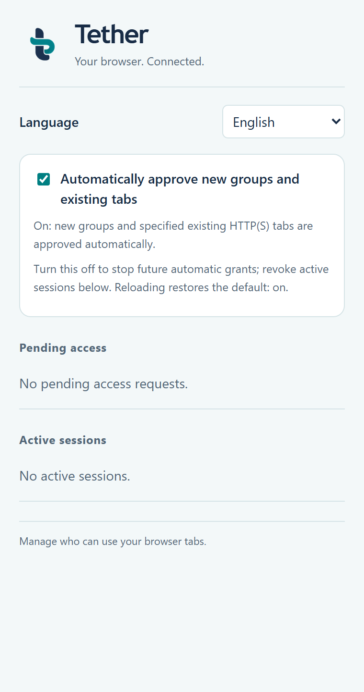

<p align="center">
  
</p>

<h1 align="center">Tether</h1>

<p align="center"><strong>Your browser. Connected.</strong></p>

[简体中文](README.zh-CN.md) · [Prototype guide](prototype/README.md) · [原型中文指南](prototype/README.zh-CN.md) · [Verification record](prototype/VERIFICATION.md) · [Brand assets](assets/README.md)

Tether lets an authorized local client control explicitly granted pages in an already-running Chrome browser through a browser extension and a local TLS WebSocket broker. It does not launch a browser or require a separate browser profile.

The extension popup supports English and Simplified Chinese through Chrome locale catalogs. It follows the browser language by default and remembers the selected language locally; see the [internationalization guide](docs/I18N.md) / [简体中文指南](docs/I18N.zh-CN.md).

## Features

- Node.js and Python clients, plus a stdio MCP server.
- Create a task tab group (`newGroup`) or attach to one explicitly selected existing HTTP(S) tab (`attachExisting`).
- Session-scoped page permissions, client authentication, TLS certificate and SPKI pin checks, and request sequence deduplication.
- Localhost by default; LAN listening requires explicit setup and matching per-client credentials.

## Architecture

```text
Existing Chrome → Tether MV3 extension → Native Messaging → local TLS WebSocket broker
                                                               ├─ Node.js SDK
                                                               ├─ Python SDK
                                                               └─ stdio MCP
```

## Quick start

See the [prototype guide](prototype/README.md) for prerequisites, first-time setup, browser extension loading, client configuration, and security boundaries. From `Tether/prototype`, the initial setup is:

```powershell
npm ci
python -m pip install -r python/requirements.txt
python scripts/setup.py
& "$env:SystemRoot\System32\WindowsPowerShell\v1.0\powershell.exe" -NoProfile -NonInteractive -ExecutionPolicy Bypass -File scripts/launchers.ps1
& ./scripts/register.ps1
npm run build
```

The guide also documents how to start the local broker and register Native Messaging. Keep the generated `.local/` credentials and private keys on this machine.

## Identity

The folded tether mark connects a navy stem with a teal loop. [Brand assets](assets/README.md) include the transparent master and extension icons.



*Popup preview uses simulated data; it does not connect to a running broker.*

## Repository layout

- `assets/` — Tether brand assets.
- `prototype/` — current extension, broker, SDKs, MCP server, setup scripts, and verification evidence.
- `prototype/README.md` — full English operating guide.
- `prototype/README.zh-CN.md` — full Simplified Chinese operating guide.
- [Internationalization guide](docs/I18N.md) / [国际化指南](docs/I18N.zh-CN.md) — popup locales, language preference, and translation workflow.
- [M0 plan](prototype/PLAN.md) / [M0 计划](prototype/PLAN.zh-CN.md), [verification](prototype/VERIFICATION.md) / [验收记录](prototype/VERIFICATION.zh-CN.md), and [brand verification](assets/branding-verification.md) / [品牌验收](assets/branding-verification.zh-CN.md).

## Agent skill

Ask an agent to read [skills/tether-browser/SKILL.md](skills/tether-browser/SKILL.md) before using Tether. It covers connection checks, session approval, page IDs, write sequencing, uncertain outcomes and cleanup, with setup and SDK references loaded only when needed. A [Simplified Chinese reading copy](skills/tether-browser/SKILL.zh-CN.md) is included.

For an agent host that supports folder-based skills, copy the entire `skills/tether-browser/` folder to its configured skill directory, then invoke `$tether-browser`. The skill still needs the actual Tether checkout and MCP connection; copying it does not install the extension, create credentials, configure MCP or start Broker.

## Status

This repository contains a working prototype with recorded build, simulated, protocol, and real Chrome evidence. Read [VERIFICATION.md](prototype/VERIFICATION.md) for exactly what passed and what remains unverified. Edge, a second LAN machine, and several M0 items remain unverified or unimplemented; the evidence does not establish a complete zero-external-traffic guarantee for the browser profile.

MCP tool descriptions and setup/register/launcher status messages also support `BB_LANGUAGE=en` or `BB_LANGUAGE=zh-CN`; see the internationalization guide for configuration.
