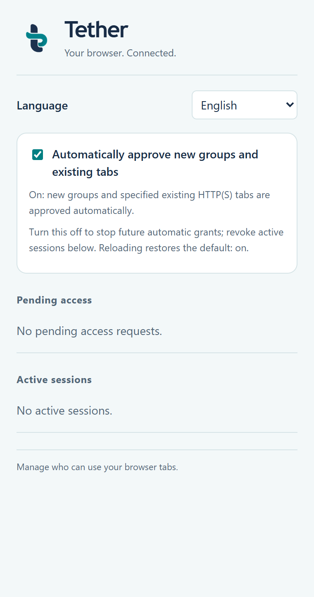

<p align="center">
  
</p>

<h1 align="center">Tether</h1>

<p align="center"><strong>Your browser. Connected.</strong></p>

[简体中文](README.zh-CN.md) · [Install guide](docs/INSTALL.md) · [安装指南](docs/INSTALL.zh-CN.md) · [Runtime guide](prototype/README.md) · [运行指南](prototype/README.zh-CN.md) · [Verification summary](prototype/VERIFICATION.md) · [Brand assets](assets/README.md)

Tether lets an authorized local client control explicitly granted pages in an already-running Chrome browser through a browser extension and a local TLS WebSocket broker. It does not require a separate browser profile. When no browser is connected, the MCP server starts the installed Chrome/Edge in the background (`--no-startup-window`) so the extension can connect; set `BB_BROWSER_WAKE=0` to turn this off.

Tether is intended for personal browser tasks and small-team workflows where an agent or script needs scoped access to a user's existing browser. Its Messenger sandbox is a separate, autonomous test environment with a dedicated browser; it is not the security boundary for ordinary Tether sessions.

The extension popup supports English and Simplified Chinese through Chrome locale catalogs. It follows the browser language by default and remembers the selected language locally; see the [internationalization guide](docs/I18N.md) / [简体中文指南](docs/I18N.zh-CN.md).

## Features

- [Messenger test sandbox](sandbox/README.md): autonomous extension testing through eight MCP tools, with container shell, Playwright, screenshots and unrestricted CDP inside a dedicated browser.
- Network inspection (`network`): capture requests on an authorized page, inspect headers, payloads, response status and bodies, with URL/type filters and pagination.
- Support tools (`diagnose`, `wait`, `assert`, `records`) report runtime state, wait for page conditions, and export up to 200 identity-isolated in-memory metadata records.
- Page-scoped business tools handle file-input uploads, same-origin GET downloads, JavaScript dialogs, and explicitly selected popups. Uploads cap at 16 MiB per file; downloads cap at 16 MiB and do not capture arbitrary browser downloads.
- Node.js and Python clients, plus a stdio MCP server.
- Create a task tab group (`newGroup`) or attach to one explicitly selected existing HTTP(S) tab (`attachExisting`).
- Session-scoped page permissions, client authentication, TLS certificate and SPKI pin checks, and request sequence deduplication.
- Element snapshot with refs (`snapshot`), complete main-document HTML readback in bounded pages (`html`), precise locator lookup (`locate`), and click/fill that resolve nested text such as `button > div > span` to exactly one element or refuse with candidates.
- Localhost by default; LAN listening requires explicit setup and matching per-client credentials.

## Architecture

```text
Existing Chrome → Tether MV3 extension → Native Messaging → local TLS WebSocket broker
                                                               ├─ Node.js SDK
                                                               ├─ Python SDK
                                                               └─ stdio MCP
```

## Quick start

Use the [installation guide](docs/INSTALL.md) for the CLI-based Windows setup and browser extension loading. The root npm package is private and not published; install from a checkout or local tarball. The repository has no lockfile, so `npm install --package-lock=false` resolves dependencies through the registry/mirror configured for npm. The historical `prototype/` directory contains the current runtime source and its [operating guide](prototype/README.md).

Fresh Windows installation requires Node.js 22+ and Python 3.10+. After the installer opens the extension manager and folder, manually enable Developer mode, choose **Load unpacked**, and select the extension folder itself. This final browser step is required before Tether can connect. See [installation](docs/INSTALL.md) for upgrade and configuration details.

```powershell
npm install --package-lock=false
node bin/tether.mjs install
```
Versions follow `a.b.c`: major features or incompatible changes increment `a`, compatible features increment `b`, and fixes increment `c`. Major releases update all companion components and documentation. See the [3.1.0 release notes](docs/RELEASE-v3.1.0.md).
The installer auto-detects supported agent hosts, and a single command prepares the runtime, configures them, and opens the extension manager page and folder. The installer itself does not start Broker; once loaded, the extension manages it in default `auto` mode and probes every 30 seconds. MCP and Native Host can start Broker for the same runtime. Shared runtime mode `off` prevents MCP from starting it again. The default policy allows all requests, and `tether policy` adds fine-grained allow/deny/ask rules when wanted. Keep generated runtime credentials and private keys on this machine.

## First browser task

Follow this order: `capabilities` → `requestSession` → check `approvalStatus` → take the granted `sessionId` and `pageId` from approval results or `listTabs` → use `snapshot` or `locate` to identify elements → perform the requested operation → inspect the resulting page state → `release` the session. Serialize writes with an increasing session-local `seq`, including release. If a write times out, inspect its outcome before deciding what to do next. The [browser skill](skills/tether-browser/SKILL.md) documents the current tool parameters and approval flow.

## Common commands

Common CLI checks and controls:

```powershell
node bin/tether.mjs doctor --home "$env:LOCALAPPDATA\Tether"
node bin/tether.mjs extension --runtime "$env:LOCALAPPDATA\Tether\runtime" --browser chrome --open-browser
node bin/tether.mjs policy list
node bin/tether.mjs policy add --effect deny --actions fill,click,navigate --origin https://*.example.com
```

`doctor` checks runtime metadata and expected files statically; it does not test connectivity or launch Broker. `extension` opens the extension loading page and folder. `policy` lists or changes the runtime's page-action rules; the default policy is `allow`, so add restrictions when the task needs them.

## Network inspection

Call `network` with `op: start` before triggering requests. It records up to 500 recent requests per page. Use `list` to find request IDs, `detail` for headers and metadata, `body` for paginated response content (continue with `nextOffset`), `stop` to retain results without continuing capture, and `clear` to discard them. Each call needs the authorized `sessionId` and `pageId`. Metadata may be truncated, and Chrome may evict response bodies. Capture covers the authorized page target and same-process frames; separate worker and out-of-process iframe (OOPIF) targets are outside the current bridge scope. Network records can contain cookies, authorization headers, and private payloads; handle them within the user's task and avoid logging them. Full CDP access in the Messenger sandbox applies only to its dedicated test browser.

## Troubleshooting and development

| Symptom | What to check |
| --- | --- |
| Browser is not connected | Load or reload the unpacked extension, then check its popup and `capabilities`. |
| Session remains pending | Check the extension popup for the approval request and approve the intended page. |
| Page or element is missing | Refresh `snapshot`/`locate` results and use current page IDs and refs. |
| Network body is unavailable | Start capture before triggering the request, then wait for completion; Chrome may also have evicted the body. |

For development, run `npm test` and `npm run docs:check` from the repository root; runtime changes also use the build and tests in `prototype/`. See [development and releases](docs/DEVELOPMENT.md), [SDK reference](skills/tether-browser/references/sdk.md), and [protocol guide](prototype/README.md).

## Identity

The folded tether mark connects a navy stem with a teal loop. [Brand assets](assets/README.md) include the transparent master and extension icons.



*Popup preview uses simulated data; it does not connect to a running broker.*

## Repository layout

- `assets/` — Tether brand assets.
- `prototype/` — current extension, broker, SDKs, MCP server, and setup/build scripts; the historical directory name is retained for compatibility.
- `prototype/README.md` — English runtime guide.
- `prototype/README.zh-CN.md` — Simplified Chinese runtime guide.
- [Install guide](docs/INSTALL.md) / [安装指南](docs/INSTALL.zh-CN.md) — install the CLI, configure supported agents, and load the browser extension.
- [Internationalization guide](docs/I18N.md) / [国际化指南](docs/I18N.zh-CN.md) — popup locales, language preference, and translation workflow.
- [Verification summary](prototype/VERIFICATION.md) / [验收摘要](prototype/VERIFICATION.zh-CN.md).

- [Development and releases](docs/DEVELOPMENT.md) — `dev` integration and `main` release workflow.
- [Tether 3.1.0 release notes](docs/RELEASE-v3.1.0.md) / [简体中文](docs/RELEASE-v3.1.0.zh-CN.md).

## Agent skill

Ask an agent to read [skills/tether-browser/SKILL.md](skills/tether-browser/SKILL.md) before using Tether. It covers connection checks, session approval, page IDs, write sequencing, uncertain outcomes and cleanup, with setup and SDK references loaded only when needed. A [Simplified Chinese reading copy](skills/tether-browser/SKILL.zh-CN.md) is included.

The installer copies the full skill folder and configures MCP for supported agent hosts. See the [installation guide](docs/INSTALL.md). For manual skill installation, copy the entire `skills/tether-browser/` folder to the host's configured skill directory, then invoke `$tether-browser`.

## Updating an installed runtime

The installed runtime can update itself from the official GitHub repository's `main` branch. Updating requires Git and a standard Node.js installation with npm; the updater shallow-clones the source to a temporary directory, runs `npm install --package-lock=false`, then invokes the new installer's runtime upgrade. It preserves the existing runtime configuration. Updates are manual and are never scheduled automatically.

Run `node bin/tether.mjs update --runtime "<runtime path>"` from a source checkout, or double-click `update.cmd` in the installed runtime directory. You can also run `node scripts/update.mjs zh-CN` there. `--dry-run` checks the target without network access or writing files. The updater follows `main`, not GitHub Releases, so it installs the latest committed main-branch state.

After an update, reconnect existing MCP clients so they reload Tether's tool definitions. An update lock at `.local/update.lock` prevents concurrent runs. If an update was interrupted, first verify its process has stopped; only then remove the stale lock and retry. The updater cleans its temporary checkout and lock when a run finishes or fails.

## Status

This repository contains the current runtime source and dated build, installation, protocol, and real Chrome acceptance records. Read the [verification summary](prototype/VERIFICATION.md) for recorded results and their limits. The evidence does not establish compatibility with every browser or a zero-external-traffic guarantee for the browser profile.

MCP tool descriptions and setup/register/launcher status messages also support `BB_LANGUAGE=en` or `BB_LANGUAGE=zh-CN`; see the internationalization guide for configuration.
