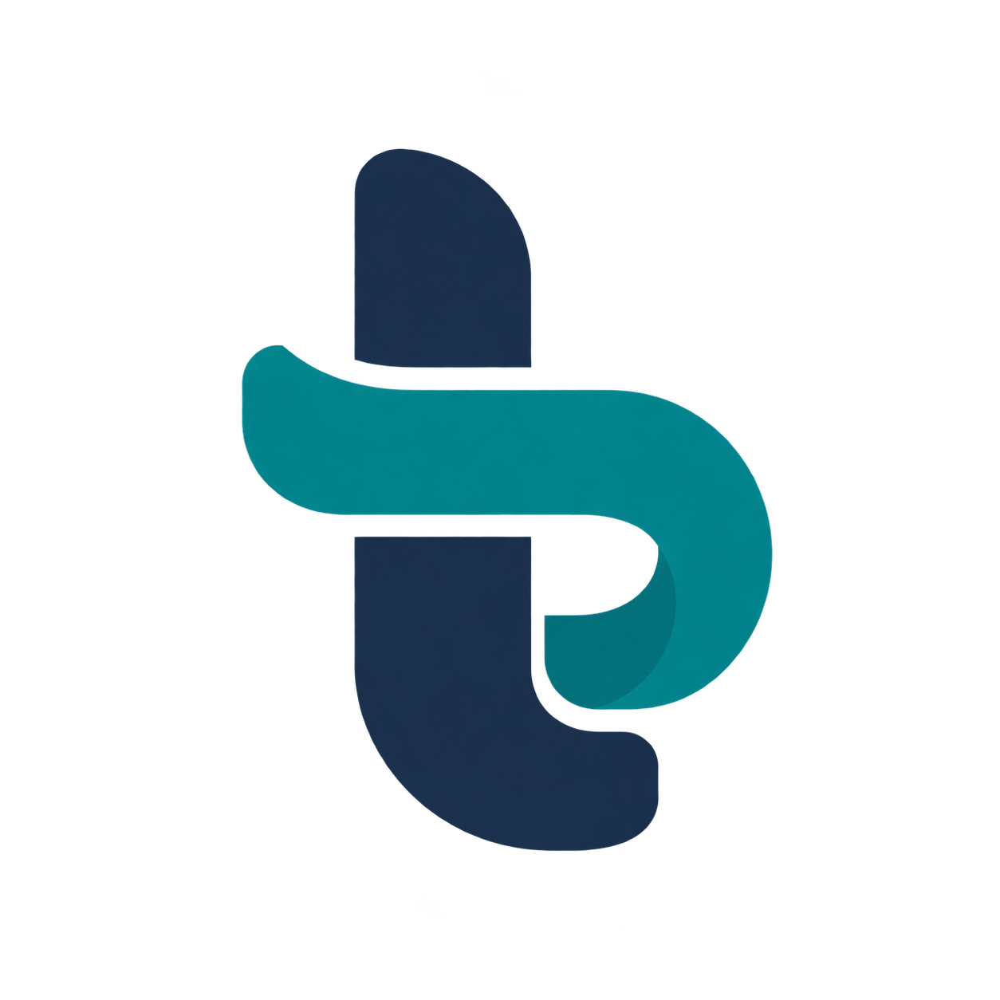
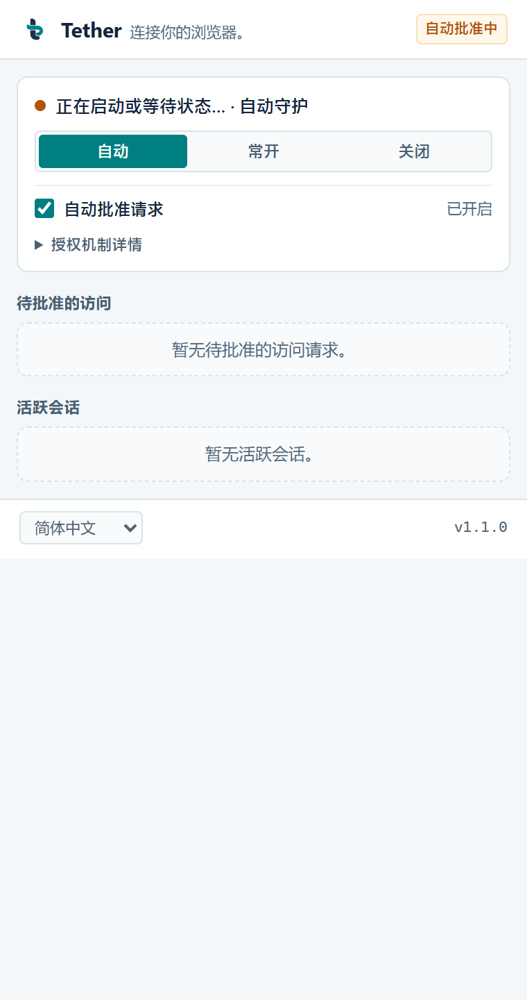

<p align="center">
  
</p>

<h1 align="center">Tether</h1>

<p align="center"><strong>连接你的浏览器。</strong></p>

[English](README.md) · [安装指南](docs/INSTALL.zh-CN.md) · [Install guide](docs/INSTALL.md) · [运行指南（英文）](prototype/README.md) · [运行指南（简体中文）](prototype/README.zh-CN.md) · [验收摘要](prototype/VERIFICATION.zh-CN.md) · [品牌资源](assets/README.zh-CN.md)

Tether 通过浏览器扩展和本机 TLS WebSocket Broker，让经过授权的本地客户端控制已运行 Chrome 中明确授予的页面。它不要求使用独立浏览器 profile。没有已连接的浏览器时，MCP 服务会在后台（`--no-startup-window`）启动已安装的 Chrome/Edge 以便扩展连接；设置 `BB_BROWSER_WAKE=0` 可关闭。

扩展弹窗通过 Chrome 语言目录支持英文和简体中文。默认跟随浏览器语言；选择项保存在本机。机制及新增语言步骤见[国际化指南](docs/I18N.zh-CN.md) / [英文版](docs/I18N.md)。

## 功能

- 提供 Node.js、Python 客户端及 stdio MCP 服务。
- 可新建任务标签组（`newGroup`），也可接管客户端明确指定的一个已有 HTTP(S) 标签（`attachExisting`）。
- 按会话授予页面权限，并提供客户端认证、TLS 证书与 SPKI pin 校验、请求序号去重。
- 带 ref 的元素快照（`snapshot`）、精确定位器查询（`locate`），click/fill 会把 `button > div > span` 等嵌套文字解析为唯一元素，否则拒绝并给出候选。
- 默认仅监听本机；局域网监听需要显式配置，并为每个客户端配置匹配的凭据。

## 架构

```text
已运行的 Chrome → Tether MV3 扩展 → Native Messaging → 本机 TLS WebSocket Broker
                                                               ├─ Node.js SDK
                                                               ├─ Python SDK
                                                               └─ stdio MCP
```

## 快速开始

使用[安装指南](docs/INSTALL.zh-CN.md)通过 CLI 安装 Windows runtime 并加载浏览器扩展。根目录 npm 包为私有包，未发布到 npm；请从检出目录或本地 tarball 安装。历史目录名 `prototype/` 仍用于兼容路径，其中包含当前运行时源码和[运行指南](prototype/README.zh-CN.md)。

```powershell
npm ci
node bin/tether.mjs install
```
安装器会自动检测受支持的 Agent 宿主，一条命令完成 runtime 准备与配置，并打开扩展管理页和扩展目录。安装器本身不启动 Broker；加载扩展后默认由 `auto` 模式管理，每 30 秒探测一次。MCP 与 Native Host 都可拉起同一 runtime 的 Broker；共享 runtime 模式为 `off` 时，MCP 不会重新拉起。默认策略全放行，需要精细控制时可用 `tether policy` 添加 allow/deny/ask 规则。生成的 runtime 凭据与私钥应留在本机。

## 品牌

Logo 以青绿色连接环绕过深蓝色竖笔，形成小写 t。[品牌资源](assets/README.zh-CN.md)包含透明原图和扩展图标。



*弹窗预览使用模拟数据，不连接运行中的 Broker。*

## 目录

- `assets/` — Tether 品牌资源。
- `prototype/` — 当前扩展、Broker、SDK、MCP 服务及初始化/构建脚本；保留历史目录名以兼容已有路径。
- `prototype/README.md` — 英文运行指南。
- `prototype/README.zh-CN.md` — 简体中文运行指南。
- [安装指南](docs/INSTALL.zh-CN.md) / [Install guide](docs/INSTALL.md) — 安装 CLI、配置支持的 Agent 并加载浏览器扩展。
- [国际化指南](docs/I18N.zh-CN.md) / [Internationalization guide](docs/I18N.md) — 弹窗语言、语言偏好和翻译流程。
- [验收摘要](prototype/VERIFICATION.zh-CN.md) / [Verification summary](prototype/VERIFICATION.md)。

- [开发与发布](docs/DEVELOPMENT.zh-CN.md) — `dev` 开发集成与 `main` 发布流程。

## Agent Skill

使用 Tether 前，让 Agent 阅读 [skills/tether-browser/SKILL.md](skills/tether-browser/SKILL.md)。入口涵盖连接检查、会话批准、页面 ID、写操作序号、不确定结果和清理，并按需引用安装与 SDK 指南；另有[简体中文阅读版](skills/tether-browser/SKILL.zh-CN.md)。

安装器会复制完整 Skill 文件夹并为支持的 Agent 配置 MCP，详见[安装指南](docs/INSTALL.zh-CN.md)。手动安装时，将整个 `skills/tether-browser/` 复制到宿主配置的 Skill 目录，再使用 `$tether-browser`。

## 状态

仓库包含当前运行时源码，以及有日期的构建、安装、协议和真实 Chrome 验收记录。已记录结果与边界见[验收摘要](prototype/VERIFICATION.zh-CN.md)。现有证据不能证明所有浏览器均兼容，也不能保证整个浏览器 profile 没有外部流量。

MCP 工具说明和初始化、注册、启动器生成提示也支持 `BB_LANGUAGE=en` 或 `BB_LANGUAGE=zh-CN`；配置方法见国际化指南。
