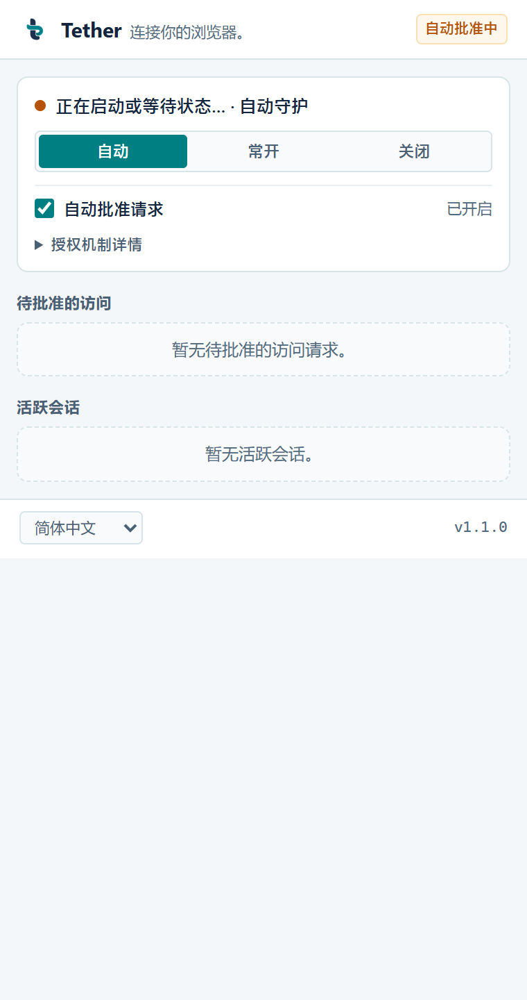

<p align="center">
  
</p>

<h1 align="center">Tether</h1>

<p align="center"><strong>连接你的浏览器。</strong></p>

[English](README.md) · [安装指南](docs/INSTALL.zh-CN.md) · [Install guide](docs/INSTALL.md) · [运行指南（英文）](prototype/README.md) · [运行指南（简体中文）](prototype/README.zh-CN.md) · [验收摘要](prototype/VERIFICATION.zh-CN.md) · [品牌资源](assets/README.zh-CN.md)

Tether 通过浏览器扩展和本机 TLS WebSocket Broker，让经过授权的本地客户端控制已运行 Chrome 中明确授予的页面。它不要求使用独立浏览器 profile。没有已连接的浏览器时，MCP 服务会在后台（`--no-startup-window`）启动已安装的 Chrome/Edge 以便扩展连接；设置 `BB_BROWSER_WAKE=0` 可关闭。

Tether 面向个人浏览器任务和小团队流程，适合 Agent 或脚本在限定授权下使用用户现有浏览器。信使沙箱是独立的无人值守测试环境，使用专用浏览器；普通 Tether 会话的安全边界由页面授权和策略控制。

扩展弹窗通过 Chrome 语言目录支持英文和简体中文。默认跟随浏览器语言；选择项保存在本机。机制及新增语言步骤见[国际化指南](docs/I18N.zh-CN.md) / [英文版](docs/I18N.md)。

## 功能

- [信使测试沙箱](sandbox/README.md)：通过八个 MCP 工具无人值守测试扩展，提供容器命令、Playwright、截图和专用浏览器的完整 CDP 控制。
- 网络流量检查（`network`）：监听已授权页面的请求，查看请求头、请求正文、响应状态和响应正文，按 URL/类型筛选与分页读取。
- 支持工具（`diagnose`、`wait`、`assert`、`records`）可报告运行状态、等待页面条件，并导出最多 200 条按身份隔离的内存元数据。
- 页面业务工具支持文件输入框上传、同源 GET 下载、JavaScript 对话框以及显式选择的弹窗。上传每文件上限 16 MiB；下载上限 16 MiB，且不捕获任意浏览器下载。
- 提供 Node.js、Python 客户端及 stdio MCP 服务。
- 可新建任务标签组（`newGroup`），也可接管客户端明确指定的一个已有 HTTP(S) 标签（`attachExisting`）。
- 按会话授予页面权限，并提供客户端认证、TLS 证书与 SPKI pin 校验、请求序号去重。
- 带 ref 的元素快照（`snapshot`）、按页读取完整主文档 HTML（`html`）、精确定位器查询（`locate`）；click/fill 会把 `button > div > span` 等嵌套文字解析为唯一元素，否则拒绝并给出候选。
- 默认仅监听本机；局域网监听需要显式配置，并为每个客户端配置匹配的凭据。

## 架构

```text
已运行的 Chrome → Tether MV3 扩展 → Native Messaging → 本机 TLS WebSocket Broker
                                                               ├─ Node.js SDK
                                                               ├─ Python SDK
                                                               └─ stdio MCP
```

## 快速开始

使用[安装指南](docs/INSTALL.zh-CN.md)通过 CLI 安装 Windows runtime 并加载浏览器扩展。根目录 npm 包为私有包，未发布到 npm；请从检出目录或本地 tarball 安装。仓库不含 lockfile，`npm install --package-lock=false` 会按本机 npm 配置的 registry/镜像解析依赖。历史目录名 `prototype/` 仍用于兼容路径，其中包含当前运行时源码和[运行指南](prototype/README.zh-CN.md)。

全新 Windows 安装需要 Node.js 22+ 和 Python 3.10+。安装器打开扩展管理页和目录后，仍需手动启用开发者模式、选择 **Load unpacked**，并选中扩展目录本身。完成这一步后 Tether 才能连接。升级和配置细节见[安装指南](docs/INSTALL.zh-CN.md)。

```powershell
npm install --package-lock=false
node bin/tether.mjs install
```
版本号使用 `a.b.c`：大功能或破坏性更新递增 `a`，兼容功能递增 `b`，修复递增 `c`。大版本必须同步更新所有配套组件和文档。详见 [3.0.1 发布说明](docs/RELEASE-v3.0.1.zh-CN.md)。
安装器会自动检测受支持的 Agent 宿主，一条命令完成 runtime 准备与配置，并打开扩展管理页和扩展目录。安装器本身不启动 Broker；加载扩展后默认由 `auto` 模式管理，每 30 秒探测一次。MCP 与 Native Host 都可拉起同一 runtime 的 Broker；共享 runtime 模式为 `off` 时，MCP 不会重新拉起。默认策略全放行，需要精细控制时可用 `tether policy` 添加 allow/deny/ask 规则。生成的 runtime 凭据与私钥应留在本机。

## 第一次浏览器任务

按此顺序操作：`capabilities` → `requestSession` → 检查 `approvalStatus` → 从批准结果或 `listTabs` 获取已授权的 `sessionId` 和 `pageId` → 用 `snapshot` 或 `locate` 确认元素 → 执行用户要求的操作 → 检查页面结果 → `release` 会话。写操作需串行执行，使用会话内递增的 `seq`，释放会话也需携带序号。写操作超时后，先核对执行结果，再决定后续动作。[浏览器 Skill](skills/tether-browser/SKILL.zh-CN.md)记录了当前工具参数和批准流程。

## 常用命令

常用 CLI 检查与控制：

```powershell
node bin/tether.mjs doctor --home "$env:LOCALAPPDATA\Tether"
node bin/tether.mjs extension --runtime "$env:LOCALAPPDATA\Tether\runtime" --browser chrome --open-browser
node bin/tether.mjs policy list
node bin/tether.mjs policy add --effect deny --actions fill,click,navigate --origin https://*.example.com
```

`doctor` 静态检查 runtime 元数据和预期文件，不测试连接，也不启动 Broker。`extension` 打开扩展加载页和目录。`policy` 用于查看或调整 runtime 的页面操作规则；默认策略为 `allow`，可按任务需要添加限制。

## 网络检查

触发请求前，调用 `network` 并设置 `op: start`，每个页面最多保留最近 500 条请求。用 `list` 查找请求 ID，`detail` 查看请求头和元数据，`body` 分页读取响应内容（通过 `nextOffset` 继续读取），`stop` 停止捕获并保留记录，`clear` 清除记录。每次调用都需携带已授权的 `sessionId` 和 `pageId`。元数据可能被截断，Chrome 也可能淘汰响应正文。捕获范围包括获授权的页面目标及同进程 frame；独立 worker 和进程外 iframe（OOPIF）不在当前桥接范围内。网络记录可能含 Cookie、授权头和私有正文，应按用户任务范围处理并避免写入日志。信使沙箱中的完整 CDP 权限仅作用于其专用测试浏览器。

## 排错与开发

| 现象 | 检查方式 |
| --- | --- |
| 浏览器未连接 | 加载或重新加载未打包扩展，检查弹窗和 `capabilities`。 |
| 会话一直等待 | 在扩展弹窗查看批准请求，并批准目标页面。 |
| 页面或元素缺失 | 刷新 `snapshot`/`locate` 结果，使用当前页面 ID 和 ref。 |
| 网络正文不可用 | 在触发请求前启动捕获，并等待请求完成；Chrome 也可能已淘汰正文。 |

开发时在仓库根目录运行 `npm test` 和 `npm run docs:check`；runtime 改动还需使用 `prototype/` 中的构建与测试命令。资料见[开发与发布](docs/DEVELOPMENT.zh-CN.md)、[SDK 参考](skills/tether-browser/references/sdk.zh-CN.md)和[协议指南](prototype/README.zh-CN.md)。

## 品牌

Logo 以青绿色连接环绕过深蓝色竖笔，形成小写 t。[品牌资源](assets/README.zh-CN.md)包含透明原图和扩展图标。



*弹窗预览使用模拟数据，不连接运行中的 Broker。*

## 目录

- `assets/` — Tether 品牌资源。
- `prototype/` — 当前扩展、Broker、SDK、MCP 服务及初始化/构建脚本；保留历史目录名以兼容已有路径。
- `prototype/README.md` — 英文运行指南。
- `prototype/README.zh-CN.md` — 简体中文运行指南。
- [安装指南](docs/INSTALL.zh-CN.md) / [Install guide](docs/INSTALL.md) — 安装 CLI、配置支持的 Agent 并加载浏览器扩展。
- [国际化指南](docs/I18N.zh-CN.md) / [Internationalization guide](docs/I18N.md) — 弹窗语言、语言偏好和翻译流程。
- [验收摘要](prototype/VERIFICATION.zh-CN.md) / [Verification summary](prototype/VERIFICATION.md)。

- [开发与发布](docs/DEVELOPMENT.zh-CN.md) — `dev` 开发集成与 `main` 发布流程。
- [Tether 3.0.1 发布说明](docs/RELEASE-v3.0.1.zh-CN.md) / [English](docs/RELEASE-v3.0.1.md)。

## Agent Skill

使用 Tether 前，让 Agent 阅读 [skills/tether-browser/SKILL.md](skills/tether-browser/SKILL.md)。入口涵盖连接检查、会话批准、页面 ID、写操作序号、不确定结果和清理，并按需引用安装与 SDK 指南；另有[简体中文阅读版](skills/tether-browser/SKILL.zh-CN.md)。

安装器会复制完整 Skill 文件夹并为支持的 Agent 配置 MCP，详见[安装指南](docs/INSTALL.zh-CN.md)。手动安装时，将整个 `skills/tether-browser/` 复制到宿主配置的 Skill 目录，再使用 `$tether-browser`。

## 更新已安装的运行时

已安装的运行时可从 GitHub 官方仓库的 `main` 分支自行更新。更新需要 Git，以及带 npm 的标准 Node.js 安装；更新器会将源码浅克隆到临时目录，运行 `npm install --package-lock=false`，再调用新安装器升级运行时，并保留现有运行时配置。更新由用户手动触发，不会定时运行。

在源码检出目录执行 `node bin/tether.mjs update --runtime "<运行时路径>"`，或在已安装的运行时目录双击 `update.cmd`。也可在那里运行 `node scripts/update.mjs zh-CN`。`--dry-run` 仅检查目标，不联网也不写文件。更新器跟随 `main`，而非 GitHub Releases，因此安装的是 `main` 上最新的已提交内容。

更新后请重新连接已有 MCP 客户端，使其重新读取 Tether 工具定义。`.local/update.lock` 锁文件用于阻止并发更新。如果更新中断，先确认对应进程已停止，再删除遗留锁文件并重试。更新器会在成功或失败后清理临时检出目录和锁文件。

## 状态

仓库包含当前运行时源码，以及有日期的构建、安装、协议和真实 Chrome 验收记录。已记录结果与边界见[验收摘要](prototype/VERIFICATION.zh-CN.md)。现有证据不能证明所有浏览器均兼容，也不能保证整个浏览器 profile 没有外部流量。

MCP 工具说明和初始化、注册、启动器生成提示也支持 `BB_LANGUAGE=en` 或 `BB_LANGUAGE=zh-CN`；配置方法见国际化指南。
